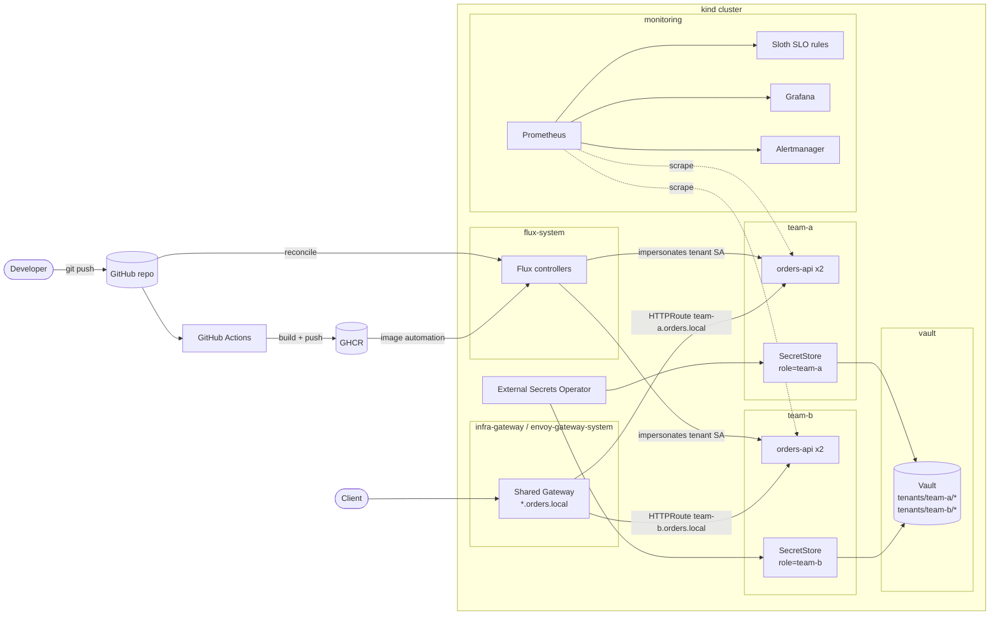
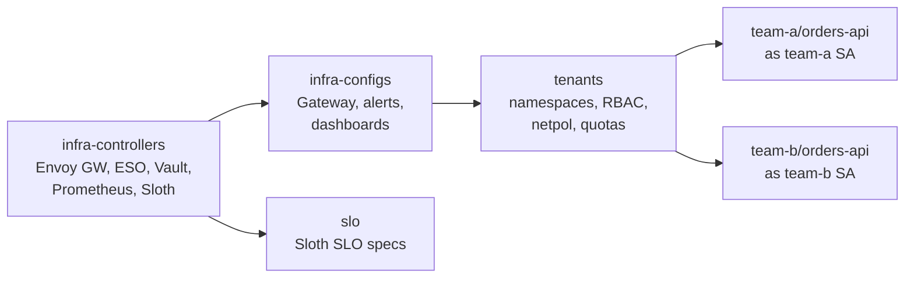

# Multi-tenant Kubernetes platform with GitOps and SLOs

A small internal developer platform that runs on a laptop. Two tenant teams ship
the same API onto one shared cluster. Each team is isolated (namespace, RBAC,
network, secrets, quotas), deploys only through Git, and has SLOs with
burn-rate alerts. A set of chaos scripts lets you break it on purpose and watch
what the platform does.

It is a scaled-down version of the kind of platform I run at work (multi-tenant
AKS with FluxCD), rebuilt from scratch with the observability layer added.

```
terraform  →  kind cluster + Flux bootstrap
Flux       →  everything else, from this repo
```

## Architecture



### Reconciliation order



## What it demonstrates

| Area | How |
|---|---|
| **GitOps** | Flux reconciles every layer from Git with explicit `dependsOn` ordering. Manual `kubectl` changes are reverted (try `make chaos-route`). |
| **Tenant isolation** | Per-tenant namespace, Pod Security `restricted`, default-deny NetworkPolicies, ResourceQuota + LimitRange, RoleBindings per group. |
| **Least privilege for deploys** | Tenant apps are applied by Flux *impersonating the tenant's service account*, so a tenant manifest can't create cluster-scoped objects or touch another namespace. |
| **Secrets** | Vault (kv-v2) → External Secrets Operator → Kubernetes Secret. Each tenant authenticates with its own Vault role and policy; team-b cannot read team-a's path. |
| **Traffic** | Gateway API: one platform-owned Gateway, tenant-owned HTTPRoutes, attachment limited to namespaces labelled `platform.io/tenant=true`. |
| **Safe rollouts** | Separate startup / liveness / readiness probes, `maxUnavailable: 0`, preStop drain, PDB, zone spread, HPA in prod. |
| **Observability** | RED metrics from the app, ServiceMonitors, kube-prometheus-stack, a Grafana dashboard provisioned from Git. |
| **SLOs** | 99.5% availability and 99% < 300ms, generated by Sloth into multi-window, multi-burn-rate alerts. |
| **Delivery** | GitHub Actions validates manifests (kustomize + kubeconform), Terraform and the app, then pushes a semver image that Flux image automation rolls out to dev. Prod is promoted by PR. |
| **Chaos** | Scripts for fault injection, pod kills and a broken route, with hypotheses written down before running them. |

## Quickstart

**Needs:** Docker, [kind](https://kind.sigs.k8s.io/) ≥ 0.24, kubectl, Terraform ≥ 1.6, the
[flux CLI](https://fluxcd.io/flux/installation/), and about 6 GB of free RAM for Docker.

```bash
# 0. Fork/push this repo to your GitHub account, then:
make init GH_USER=<your-github-user>          # fills in image + repo placeholders
git commit -am "chore: set github user" && git push

# 1. Cluster + Flux (Terraform commits clusters/dev/flux-system to your repo)
export TF_VAR_github_token=<PAT with repo scope>
make up GH_USER=<your-github-user>

# 2. Image. Either let CI push it to GHCR (make the package public),
#    or build it locally and load it into kind:
make image GH_USER=<your-github-user>

# 3. Vault: per-tenant auth, policies and secrets
make vault-setup

# 4. Check everything is green
make status
```

Then, in separate terminals:

```bash
make gateway     # http://localhost:8080
make grafana     # http://localhost:3000  (admin / admin, local only)

curl -H 'Host: team-a.orders.local' localhost:8080/
curl -H 'Host: team-b.orders.local' localhost:8080/orders
make load        # 10 min of steady traffic with SLO thresholds
```

Open **Dashboards → orders-api · SLOs** in Grafana.

## Break it

Each experiment has a written hypothesis in [`docs/chaos-experiments.md`](docs/chaos-experiments.md).
Run it, compare what actually happened, and write it up with the
[postmortem template](docs/postmortems/TEMPLATE.md).

```bash
make chaos-errors   # 20% HTTP 500s on team-a → watch burn rate & alerts
make chaos-heal
make chaos-pods     # kill pods under load → does the SLO move?
make chaos-route    # break the HTTPRoute by hand → watch Flux put it back
```

Isolation checks worth showing in an interview:

```bash
# A team-a developer can deploy in team-a but not in team-b
kubectl auth can-i create deployments -n team-a --as=alice --as-group=team-a   # yes
kubectl auth can-i create deployments -n team-b --as=alice --as-group=team-a   # no

# team-b's Vault role cannot read team-a's secret
kubectl -n vault exec vault-0 -- sh -c 'VAULT_TOKEN=root vault token create -policy=team-b -field=token' \
  | xargs -I{} kubectl -n vault exec vault-0 -- env VAULT_TOKEN={} vault kv get tenants/team-a/orders-api   # 403

# Nothing outside the Gateway can reach a tenant pod (default-deny ingress)
kubectl run probe --rm -it --image=busybox --restart=Never -- \
  wget -qO- -T 3 http://orders-api.team-b.svc   # times out
```

## Repository layout

```
terraform/                 kind cluster + flux_bootstrap_git
clusters/{dev,prod}/       Flux entrypoints: layers, order, image automation (dev)
infrastructure/
  controllers/             HelmReleases: Envoy Gateway, ESO, Vault, kube-prometheus-stack, Sloth
  configs/                 Gateway, platform alerts, Flux PodMonitor, Grafana dashboards
tenants/
  base/                    guardrails every tenant gets
  team-a/, team-b/         namespace, owning group, Vault role, app sync (sync.yaml)
apps/orders-api/
  app/, tests/, Dockerfile FastAPI service with RED metrics and fault injection
  k8s/base, overlays/      Kustomize: dev (image automation) and prod (3 replicas, HPA, stricter PDB)
slo/                       Sloth SLO specs per tenant
scripts/                   setup, validation, chaos
loadtest/                  k6
docs/
  adr/                     why things are the way they are
  runbooks/                what to do when an alert fires
  postmortems/             write-ups of things I broke
  chaos-experiments.md     hypotheses before each experiment
```

## Decisions

- [ADR 0001 – Flux over Argo CD](docs/adr/0001-flux-over-argocd.md)
- [ADR 0002 – Tenant isolation model](docs/adr/0002-tenant-isolation-model.md)
- [ADR 0003 – Vault + External Secrets, dev mode locally](docs/adr/0003-vault-and-external-secrets.md)
- [ADR 0004 – SLO targets and burn-rate alerting](docs/adr/0004-slo-targets-and-alerting.md)

## Known limitations

- Vault runs in dev mode (in-memory). Restarting the pod loses its data; re-run `make vault-setup`.
- Chaos state lives in pod memory, so a restarted pod comes back healthy.
- Alertmanager routes to a null receiver. Point it at Slack or a webhook to get real notifications.
- Chart versions use ranges so the lab installs today; pin exact versions once you've tested them.
- kind's built-in CNI enforces NetworkPolicy from kind v0.24. On older versions, install Calico or Cilium.

## What I'd do next

- Loki for logs and OpenTelemetry tracing (tracing with tail sampling is done in my payments-reliability-lab project)
- Kyverno policies (require probes, block `:latest`, enforce labels) instead of relying on review
- Flagger canary on the Gateway, gated on the SLO burn rate
- Same layout on AKS with Workload Identity in place of Vault's Kubernetes auth
